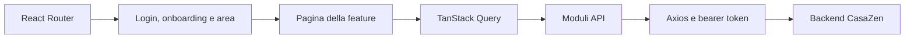

# Architettura webapp

## Flusso principale

## Responsabilità

| Percorso | Responsabilità |
|---|---|
| `src/routes/` | Albero router, redirect, boundary delle pagine pubbliche e protette |
| `src/config/route-manifest.ts` | Pagine operative, permessi, flag e metadati di navigazione |
| `src/components/auth/` | Login, onboarding e guard delle aree |
| `src/components/layout/` | Shell condivisa, header, sidebar, barra mobile e focus di navigazione |
| `src/features/` | Pagine, componenti e modelli per dominio |
| `src/api/` | Contratti HTTP per dominio; client condiviso in `src/api/client.ts` |
| `src/queries/` | Query, mutazioni e invalidazione; hook fornitori suddivisi in `supplier/` |
| `src/lib/axios.ts` | Base URL, token e gestione centralizzata degli errori |
| `src/store/` | Stato UI locale con Zustand |
| `src/i18n/` | Risorse italiano/inglese e configurazione traduzioni |
| `src/site/` | Rendering delle pagine pubbliche, distinto dall’app autenticata |

## Routing e autorizzazioni

Le aree sono `short-rent`, `long-rent`, `account`, `supplier` e `admin`. `account` è l’amministrazione dell’organizzazione cliente; `admin` è la console staff della piattaforma.

Il router applica `ProtectedRoute`, `OnboardingGuard` e il workspace alle pagine applicative. `ContextRouteGuard` verifica area, permessi e flag; la shell viene condivisa tra le pagine. Questi controlli orientano l’interfaccia: l’autorizzazione sui dati resta responsabilità dell’API.

La guida è una route `help` esplicita in ciascuna area, all’interno degli stessi guard. Il link usa lo slot `help` dell’header. Non si aggiunge al manifest operativo e non occupa un posto nella barra mobile. Le pagine pubbliche e il sito degli host mantengono i propri alberi di route.

## Notifiche in tempo reale

La campanella dell'header (`src/features/notifications/`, slot `notifications` della shell) mostra le notifiche dell'utente (`GET /api/me/notifications`, `unread-count`, `read`, `read-all`). Il canale in tempo reale è l'hub SignalR `/hubs/notifications`, sull'origine dell'API (`VITE_API_BASE_URL` senza `/api`), con il token Auth0 come `accessTokenFactory`.

- **Connessione:** una per scheda (client condiviso, aperto dal primo utilizzo e chiuso dall'ultimo), solo con utente Auth0 autenticato; mai in demo, nelle pagine pubbliche o per un ospite. WebSocket con i fallback della negoziazione; riconnessione con backoff 0, 2, 5, 10, 30 s (poi ogni 30 s). La libreria si carica solo quando serve (import dinamico).
- **Evento:** `notificationsChanged { unreadCount, type, entityId }` scrive il contatore nella cache e rilegge `['notifications']`, `['host-threads']`, `['booking-messages-unread']` e, se l'entità è una prenotazione, `['booking-thread', id]`. Dopo una riconnessione si rilegge tutto (gli eventi persi non tornano).
- **Rete di sicurezza:** il contatore si rilegge al focus della finestra e al ritorno della rete; con il socket interrotto, poll ogni 60 s.
- **Tipi:** `notification-model.ts` collega ogni tipo (`PushTypes` del backend) a icona, frase (`notifications.types.*`, it/en) e destinazione; un tipo sconosciuto ha la frase generica e non apre nulla. L'`entityId` dipende dal tipo e non è mai una prenotazione per default: solo `guest-message` rilegge un thread.

  | Tipi | `entityId` | Destinazione |
  |---|---|---|
  | `new-booking`, `booking-request`, `booking-cancelled-by-guest`, `checkout-reminder`, `ota-stay-review` | prenotazione | `/app/short-rent/bookings/{id}` (la lista non ha una vista «richieste») |
  | `guest-message` | prenotazione | `…/bookings/{id}?tab=messages` |
  | `guest-data-missing` | prenotazione | `…?tab=guest` |
  | `alloggiati-*` | prenotazione | `…?tab=alloggiati` |
  | `deferred-charge-failed`, `deferred-charge-cancelled` | prenotazione | `…?tab=payment` |
  | `service-request-*`, `service-payment-*` | richiesta di servizio | fornitore: `/app/supplier/inbox/{id}`; host: `/app/short-rent/marketplace` («Le tue richieste») |
  | `property-mode-change-*` | immobile | `/app/{short-rent\|long-rent}/properties/{id}` (la sezione corrente) |
  | `property-compliance-suspended`, `cin-deadline` | immobile | `/app/short-rent/properties/{id}/activation` |
  | `rent-payment-received` | immobile | `/app/long-rent/properties/{id}` |
- **Badge per elemento:** `GET /api/messages/unread` (una sola query per pagina) alimenta il contatore dei messaggi non letti sulle prenotazioni del calendario e della Timeline (`UnreadMessagesContext`), sulle righe «Rispondi» della Home e sul titolo dei messaggi nel cassetto. Un thread si segna come letto solo con la scheda visibile.

## Convenzioni

- Richieste attraverso i moduli API e il client condiviso; niente `fetch('/api/...')` nelle feature.
- Dati server in TanStack Query; dopo una mutazione invalidare tutte le query interessate, comprese le varianti filtrate.
- Testi UI tramite i18next, con chiavi corrispondenti in italiano e inglese.
- Componenti piccoli e responsabilità separate; estrarre modelli puri quando aiutano i flussi. Non duplicare la shell nelle nuove pagine.
- Date di soggiorno tramite `src/lib/stay-dates.ts`: tagliare un ISO UTC può produrre il giorno precedente in Italia.
- HTML esterno solo attraverso la sanitizzazione condivisa. La guida usa testo React, senza HTML iniettato.
- Moduli e controlli accessibili, focus visibile, etichette per icone e supporto al layout mobile.
- Mai registrare token o dati personali nella console; nessun segreto nelle variabili `VITE_*`.

Per le procedure di Auth0, storage, Stripe, Alloggiati e iCal usare i [runbook backend](https://github.com/casazen/backend/blob/develop/docs/runbooks/index.md).
