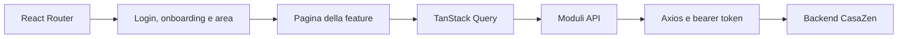

# Architettura webapp

## Flusso principale

## Responsabilità

| Percorso | Responsabilità |
|---|---|
| `src/routes/` | Albero router, redirect, boundary delle pagine pubbliche e protette |
| `src/config/route-manifest.ts` | Pagine operative, permessi, flag e metadati di navigazione |
| `src/components/auth/` | Login, onboarding e guard delle aree |
| `src/components/layout/` | Shell condivisa, header, sidebar, barra mobile e focus di navigazione |
| `src/features/` | Pagine, componenti e modelli per dominio |
| `src/api/` | Contratti HTTP per dominio; client condiviso in `src/api/client.ts` |
| `src/queries/` | Query, mutazioni e invalidazione; hook fornitori suddivisi in `supplier/` |
| `src/lib/axios.ts` | Base URL, token e gestione centralizzata degli errori |
| `src/store/` | Stato UI locale con Zustand |
| `src/i18n/` | Risorse italiano/inglese e configurazione traduzioni |
| `src/site/` | Rendering delle pagine pubbliche, distinto dall’app autenticata |

## Routing e autorizzazioni

Le aree sono `short-rent`, `long-rent`, `account`, `supplier` e `admin`. `account` è l’amministrazione dell’organizzazione cliente; `admin` è la console staff della piattaforma.

Il router applica `ProtectedRoute`, `OnboardingGuard` e il workspace alle pagine applicative. `ContextRouteGuard` verifica area, permessi e flag; la shell viene condivisa tra le pagine. Questi controlli orientano l’interfaccia: l’autorizzazione sui dati resta responsabilità dell’API.

La guida è una route `help` esplicita in ciascuna area, all’interno degli stessi guard. Il link usa lo slot `help` dell’header. Non si aggiunge al manifest operativo e non occupa un posto nella barra mobile. Le pagine pubbliche e il sito degli host mantengono i propri alberi di route.

## Notifiche in tempo reale

La campanella dell'header (`src/features/notifications/`, slot `notifications` della shell) mostra le notifiche dell'utente (`GET /api/me/notifications`, `unread-count`, `read`, `read-all`). Il canale in tempo reale è l'hub SignalR `/hubs/notifications`, sull'origine dell'API (`VITE_API_BASE_URL` senza `/api`), con il token Auth0 come `accessTokenFactory`.

- **Connessione:** una per scheda (client condiviso, aperto dal primo utilizzo e chiuso dall'ultimo), solo con utente Auth0 autenticato; mai in demo, nelle pagine pubbliche o per un ospite. WebSocket con i fallback della negoziazione; riconnessione con backoff 0, 2, 5, 10, 30 s (poi ogni 30 s). La libreria si carica solo quando serve (import dinamico).
- **Evento:** `notificationsChanged { unreadCount, type, entityId }` scrive il contatore nella cache e rilegge `['notifications']`, `['host-threads']`, `['booking-messages-unread']` e, se l'entità è una prenotazione, `['booking-thread', id]`. Dopo una riconnessione si rilegge tutto (gli eventi persi non tornano). Il check-in online completato dall'ospite (`guest-checkin-completed`, e dopo una riconnessione) rilegge anche i dati che cambia: `['bookings']`, `['checkin-session']` (il passo «Cosa succede ora»), `['alloggiati']`, `['compliance']`, `['dashboard']`, `['guests']` (`STALE_ON_CHECK_IN` in `use-notifications-realtime.ts`): la pagina aperta davanti all'host si aggiorna senza ricaricarla. Un nuovo evento con dati da rileggere si aggiunge lì.
- **Avviso a schermo:** una nuova notifica compare subito come messaggio (`toast` di sonner, con «Apri» verso la destinazione del tipo), una volta per evento (`id` = tipo e entità). Una notifica è nuova quando il contatore cresce: leggere un thread fa arrivare lo stesso tipo, ma il contatore scende e non compare nulla (`onNewNotification` dell'hook, usato dalla campanella).
- **Rete di sicurezza:** il contatore si rilegge al focus della finestra e al ritorno della rete; con il socket interrotto, poll ogni 60 s.
- **Tipi:** `notification-model.ts` collega ogni tipo (`PushTypes` del backend) a icona, frase (`notifications.types.*`, it/en) e destinazione. Un tipo sconosciuto ha la frase generica e non apre nulla. `guest-message` apre `/app/short-rent/bookings/{id}?tab=messages`; `guest-checkin-completed` apre `/app/short-rent/bookings/{id}?tab=guest` (Documenti); i `service-request-*` aprono la posta del fornitore (`/app/supplier/inbox/{id}`) o «Le mie app» del marketplace dell'host (`/app/short-rent/marketplace/mine`: i fornitori già richiesti e le richieste).
- **Badge per elemento:** `GET /api/messages/unread` (una sola query per pagina) alimenta il contatore dei messaggi non letti sulle prenotazioni del calendario e della Timeline (`UnreadMessagesContext`), sulle righe «Rispondi» della Home e sul titolo dei messaggi nel cassetto. Un thread si segna come letto solo con la scheda visibile.

## Avvisi popup

Gli avvisi proattivi (ADR-025: scadenze Alloggiati e ISTAT, check-in e check-out in sospeso, prenotazioni da controllare, errori di sincronizzazione dei canali) compaiono come una scheda in basso a destra, uno alla volta. `AlertPopup` (`src/components/shared/alert-popup.tsx`) è montato una sola volta da `AppShellLayout` con le condizioni della campanella: solo utente Auth0 autenticato, mai in demo, nelle pagine pubbliche o per un ospite.

- **Canale:** nessuna connessione propria. Gli avvisi viaggiano su quella della campanella (`/hubs/notifications`) come secondo metodo, `alertReceived { alertId, alertType, entityType, entityId, urgency }` (`ALERT_HUB_METHOD`, `parseAlert` e `RealtimeClient.onAlert` in `realtime-client.ts`; opzione `onAlert` di `useNotificationsRealtime`, con `alertsOnly` per chi non deve alimentare la cache delle notifiche, già alimentata dalla campanella). Il payload ha solo riferimenti, mai dati personali (ADR-025-R5): `parseAlert` tiene quei cinque campi e scarta il resto. Un tipo sconosciuto compare con la frase generica, un'urgenza sconosciuta vale `Normal`.
- **Coda:** `use-alert-signalr.ts` tiene la coda in `['alerts', 'pending']` (`queries/use-alerts.ts`). L'avviso che arriva dal canale vi entra subito; `GET /api/me/alerts/pending` si rilegge ogni 30 s finché il canale non è `connected`, a ogni connessione (ciò che è stato spedito mentre era giù non si ripete), al focus e al ritorno della rete. Prima il più urgente (`High`, `Normal`, `Low`), a parità l'ordine di arrivo: il payload non ha la data e il server elenca dal più vecchio.
- **Uno alla volta:** `currentAlert` è il primo della coda. «Ignora» (`POST …/dismiss`) e «Ricordamelo più tardi» (`PATCH …/remind` con un ISO 8601: tra 15 minuti, 1 ora, 4 ore, domani alle 9:00 di Roma, in `AlertRemindDialog`) lo tolgono quando il server ha preso la risposta, e compare il successivo; se il server non la prende l'avviso resta, con un messaggio. «Fallo ora» apre la prenotazione o la casa dell'avviso (`alertRoute` in `alert-model.ts`); per ogni altro tipo di entità il pulsante non c'è.
- **Non durante un wizard:** ogni flusso a passi dichiara di essere aperto con `useWizardOpenFlag` (`src/store/use-wizard-open-flag.ts`): +1 al montaggio e -1 allo smontaggio, una volta per istanza, nel conteggio `openWizards` di `useUiStore`; finché il conteggio è sopra zero la scheda non si disegna e gli avvisi aspettano in coda. Lo chiama `WizardShell`, quindi vale per tutti i wizard costruiti su di esso, e lo chiamano a mano i flussi che hanno una cornice propria: la cornice del wizard contratto (`LeaseWizardFrame`, ogni schermata di `/app/long-rent/leases/new` dal passo della casa e di `/app/long-rent/leases/:id/edit`), l'attivazione dell'immobile (`PropertyActivationWizard`, `/app/short-rent/properties/:id/activation`), il profilo fiscale (`FiscalWizardPage`, `/app/short-rent/fiscal/wizard`) e l'attivazione del fornitore (`/app/supplier/activation`). Un nuovo flusso a passi nella shell che non usa `WizardShell` deve chiamarlo, altrimenti la scheda gli si disegna sopra. Fuori dalla shell (onboarding, check-in dell'ospite, prenotazione dai siti pubblici) la scheda non è montata e non serve. I wizard non hanno un percorso comune (`/app/short-rent/properties/create`, `…/bookings/:id/checkout`, `/app/long-rent/leases/new`, …), quindi non si guarda il percorso.
- **Scadenza di legge:** un rinvio oltre la scadenza dell'avviso è rifiutato dal server (400 `cannot_snooze_past_deadline`). Il payload non porta la scadenza, quindi la scheda non può spegnere le scelte in anticipo: mostra il messaggio del server e l'avviso resta. `AlertRemindDialog` accetta `deadline` e spegne le scelte che la superano.

## Convenzioni

- Richieste attraverso i moduli API e il client condiviso; niente `fetch('/api/...')` nelle feature.
- Dati server in TanStack Query; dopo una mutazione invalidare tutte le query interessate, comprese le varianti filtrate.
- Testi UI tramite i18next, con chiavi corrispondenti in italiano e inglese.
- Componenti piccoli e responsabilità separate; estrarre modelli puri quando aiutano i flussi. Non duplicare la shell nelle nuove pagine.
- Date di soggiorno tramite `src/lib/stay-dates.ts`: tagliare un ISO UTC può produrre il giorno precedente in Italia.
- HTML esterno solo attraverso la sanitizzazione condivisa. La guida usa testo React, senza HTML iniettato.
- Moduli e controlli accessibili, focus visibile, etichette per icone e supporto al layout mobile.
- Mai registrare token o dati personali nella console; nessun segreto nelle variabili `VITE_*`.

Per le procedure di Auth0, storage, Stripe, Alloggiati e iCal usare i [runbook backend](https://github.com/casazen/backend/blob/develop/docs/runbooks/index.md).
