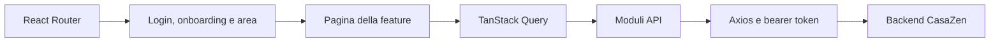

# Architettura webapp

## Flusso principale

## Responsabilità

| Percorso | Responsabilità |
|---|---|
| `src/routes/` | Albero router, redirect, boundary delle pagine pubbliche e protette |
| `src/config/route-manifest.ts` | Pagine operative, permessi, flag e metadati di navigazione |
| `src/components/auth/` | Login, onboarding e guard delle aree |
| `src/components/layout/` | Shell condivisa, header, sidebar, barra mobile e focus di navigazione |
| `src/features/` | Pagine, componenti e modelli per dominio |
| `src/api/` | Contratti HTTP per dominio; client condiviso in `src/api/client.ts` |
| `src/queries/` | Query, mutazioni e invalidazione; hook fornitori suddivisi in `supplier/` |
| `src/lib/axios.ts` | Base URL, token e gestione centralizzata degli errori |
| `src/store/` | Stato UI locale con Zustand |
| `src/i18n/` | Risorse italiano/inglese e configurazione traduzioni |
| `src/site/` | Rendering delle pagine pubbliche, distinto dall’app autenticata |

## Routing e autorizzazioni

Le aree sono `short-rent`, `long-rent`, `account`, `supplier` e `admin`. `account` è l’amministrazione dell’organizzazione cliente; `admin` è la console staff della piattaforma.

Il router applica `ProtectedRoute`, `OnboardingGuard` e il workspace alle pagine applicative. `ContextRouteGuard` verifica area, permessi e flag; la shell viene condivisa tra le pagine. Questi controlli orientano l’interfaccia: l’autorizzazione sui dati resta responsabilità dell’API.

La guida è una route `help` esplicita in ciascuna area, all’interno degli stessi guard. Il link usa lo slot `help` dell’header. Non si aggiunge al manifest operativo e non occupa un posto nella barra mobile. Le pagine pubbliche e il sito degli host mantengono i propri alberi di route.

## Convenzioni

- Richieste attraverso i moduli API e il client condiviso; niente `fetch('/api/...')` nelle feature.
- Dati server in TanStack Query; dopo una mutazione invalidare tutte le query interessate, comprese le varianti filtrate.
- Testi UI tramite i18next, con chiavi corrispondenti in italiano e inglese.
- Componenti piccoli e responsabilità separate; estrarre modelli puri quando aiutano i flussi. Non duplicare la shell nelle nuove pagine.
- Date di soggiorno tramite `src/lib/stay-dates.ts`: tagliare un ISO UTC può produrre il giorno precedente in Italia.
- HTML esterno solo attraverso la sanitizzazione condivisa. La guida usa testo React, senza HTML iniettato.
- Moduli e controlli accessibili, focus visibile, etichette per icone e supporto al layout mobile.
- Mai registrare token o dati personali nella console; nessun segreto nelle variabili `VITE_*`.

Per le procedure di Auth0, storage, Stripe, Alloggiati e iCal usare i [runbook backend](https://github.com/casazen/backend/blob/develop/docs/runbooks/index.md).
